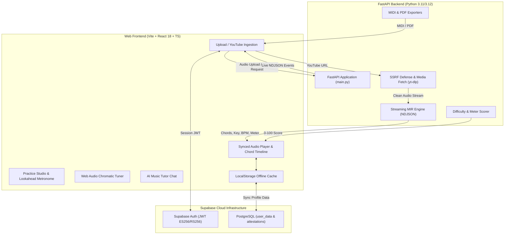

# Wilsify AI — Complete Technical & Presentation Explanation

> **Single Source of Truth** for understanding, presenting, defending, and evaluating **Wilsify AI**.  
> Every claim in this document is verified against the actual, working codebase in this repository as of **October 2026**.  
>
> **Status tags used throughout:**  
> - **IMPLEMENTED**: Confirmed in code, fully functional end-to-end, and covered by automated tests.  
> - **PREVIEW ONLY**: UI is functional in the frontend, but backend microservice endpoints are scheduled for post-MVP.  
> - **ROADMAP**: Planned for future commercial phases.

---

## Table of Contents

1. [Executive Overview & Elevator Pitch](#1-executive-overview--elevator-pitch)
2. [Wilsify AI in Simple Words](#2-wilsify-ai-in-simple-words)
3. [Complete System Architecture](#3-complete-system-architecture)
4. [Complete End-to-End Processing Pipeline](#4-complete-end-to-end-processing-pipeline)
5. [Audio Inputs & Ingestion](#5-audio-inputs--ingestion)
6. [Musical Attributes & MIR Signal Processing](#6-musical-attributes--mir-signal-processing)
7. [Why Librosa, FFmpeg & HMM Viterbi](#7-why-librosa-ffmpeg--hmm-viterbi)
8. [AI Music Tutor Architecture](#8-ai-music-tutor-architecture)
9. [Frontend Architecture & Web Audio Engineering](#9-frontend-architecture--web-audio-engineering)
10. [Backend Microservice Architecture](#10-backend-microservice-architecture)
11. [Database, Authentication & Persistence](#11-database-authentication--persistence)
12. [Security & Error Handling](#12-security--error-handling)
13. [Complete Technology Stack](#13-complete-technology-stack)
14. [Implementation Status](#14-implementation-status)
15. [Teacher / Viva Questions & Answers](#15-teacher--viva-questions--answers)
16. [Presentation Script & Demo Walkthrough](#16-presentation-script--demo-walkthrough)
17. ["Explain the Analysis" Step-by-Step](#17-explain-the-analysis-step-by-step)
18. [Final Presentation Cheat Sheet](#18-final-presentation-cheat-sheet)

---

## 1. Executive Overview & Elevator Pitch

**Wilsify AI** is an intelligent, AI-assisted music learning companion that transforms any raw audio file, video, or YouTube link into structured musical knowledge in under 60 seconds:

- **Chords:** Timestamped chord progression with confidence ratings and runner-up alternative chords.
- **Key & Scale:** Musical root key, mode (Major/Minor), and Camelot key notation.
- **Tempo & Time Signature:** Accurate beats per minute (BPM) and meter detection (4/4 or 3/4).
- **Difficulty Score:** Intelligent 0–100 playability rating categorized from Beginner to Expert.
- **Practice Studio:** Synchronized interactive chord player, harmonic transposition, capo calculation, section looping, lookahead metronome, and real-time microphone pitch accuracy tracking.
- **AI Music Tutor:** Embedded musical conversational agent with direct knowledge of the analysed song's harmonic structure.
- **Music Exports:** Export to standard MIDI and printable sheet-music PDF.

### The Elevator Pitch (30 Seconds)
> *"Musicians today have to juggle 5 or 6 separate apps to learn a single song — Chordify for chords, Tunebat for key and BPM, GuitarTuna for tuning, MuseScore for sheet music, and YouTube for lessons. Wilsify AI replaces all of them with one browser-based workstation. You upload any audio or paste a YouTube link, and in under 60 seconds our streaming MIR pipeline extracts the chords, key, tempo, and difficulty, syncs the chord sheet to the audio, and lets you practice along with an AI tutor that already understands your song."*

---

## 2. Wilsify AI in Simple Words: One App Instead of Five

| Disconnected Tools | Purpose | Wilsify AI Integrated Solution |
|---|---|---|
| **Chordify** (~$8/mo) | Chords from YouTube/Uploads | Fast streaming chord timeline with confidence and simplification |
| **Moises** (~$9.99/mo) | Stem splitting, tempo/pitch shifting | Integrated Practice Studio with speed control, looping, and pitch tracking |
| **GuitarTuna** (~$6.49/mo) | Instrument tuner via microphone | Built-in in-browser Web Audio chromatic tuner (no server needed) |
| **Ultimate Guitar** | Chords and tabs | Auto-generated chord sheet with instant transpose (-12..+12) and capo (0..7) |
| **MuseScore** | Sheet music transcription | Auto-generated sheet-music PDF and downloadable MIDI |
| **Tunebat** | Key and BPM finder | Automatic Key, scale, BPM, and Camelot wheel analysis |
| **ChatGPT / Generic AI** | General music theory | AI Music Tutor aware of the exact chords, key, and tempo of the song |

### Cost Advantage
A musician subscribing to Chordify, Moises, and GuitarTuna spends over **$24/month** without having sheet music export or an AI tutor. Wilsify AI consolidates all five into one workspace.

---

## 3. Complete System Architecture



---

## 4. Complete End-to-End Processing Pipeline

1. **Ingestion & Validation:**
   - The user selects a local audio/video file, enters a YouTube URL, records from mic, or clicks the built-in sample track.
   - For uploads, the frontend verifies file size ($\le 100\text{ MB}$) and file extensions (`.mp3`, `.wav`, `.m4a`, `.ogg`, `.flac`, `.aac`, `.wma`, `.mp4`, `.mov`, `.webm`, `.mkv`, `.avi`, `.m4v`).
   - The user accepts the copyright and rights attestation.
2. **Media Fetch (if YouTube):**
   - The backend validates the host using DNS resolution (`_assert_public_host`) to prevent SSRF attacks against private networks.
   - `yt-dlp` extracts audio with a strict 20-minute cap.
3. **NDJSON Streaming Initialization (`POST /api/analyze/stream`):**
   - The backend returns `Transfer-Encoding: chunked` with `application/x-ndjson`.
   - Event stages are emitted in sequence: `uploaded` $\rightarrow$ `decoding` $\rightarrow$ `separating` $\rightarrow$ `beats` $\rightarrow$ `chroma` $\rightarrow$ `chords` $\rightarrow$ `key` $\rightarrow$ `meter` $\rightarrow$ `result`.
4. **Signal Processing & Audio Decoding:**
   - FFmpeg decodes and normalizes the audio stream to mono 22,050 Hz.
5. **MIR Feature Extraction:**
   - **Beat & Tempo Tracking:** `librosa.beat.beat_track` extracts onset envelopes, beat frames, and BPM.
   - **Harmonic Chromagram:** Computes a 12-bin Constant-Q / harmonic chromagram (`librosa.feature.chroma_cqt`).
   - **Chord Sequence Recognition:** Evaluates cosine similarity against 48 chord templates (Major, Minor, 7, m7 across 12 pitch classes) and decodes optimal state transitions using a Hidden Markov Model with Viterbi path smoothing.
   - **Key Detection:** Global chroma vector is correlated against Temperley and Krumhansl-Schmuckler cognitive key profiles.
   - **Meter Estimation:** Downbeat energy distribution evaluates 4/4 vs 3/4 bar structures.
   - **Difficulty Rating:** Multi-factor formula computes a 0–100 playability rating.
6. **Result Assembly & Client Caching:**
   - The final JSON payload containing chords, key, BPM, difficulty, and meter is delivered.
   - The frontend immediately auto-saves the complete analysis into `localStorage` (and syncs to Supabase if signed in).
   - Audio and chord timeline synchronize for immediate playback.

---

## 5. Audio Inputs & Ingestion

- **Local Files:** 14 supported extensions covering all mainstream audio and video formats.
- **YouTube Fetch:** Search and URL extraction powered by `yt-dlp`.
- **Sample Track Generator:** Web Audio browser synthesizer (`generateSampleTrack.ts`) enabling instant zero-bandwidth testing.
- **Microphone Capture:** Direct browser audio recording with automatic WAV container encoding.

---

## 6. Musical Attributes & MIR Signal Processing

| Attribute | What it is | How it is computed | Musical Meaning |
|---|---|---|---|
| **BPM** | Beats Per Minute | `librosa.beat.beat_track` onset envelope autocorrelation | Song speed and tempo |
| **Key & Scale** | Tonal Center & Mode | Correlation against Temperley key profiles across 24 keys | The musical root (e.g., C Major, F# Minor) |
| **Chroma Vector** | 12-element energy vector | Constant-Q / STFT chromagram (`librosa.feature.chroma_cqt`) | Distribution of energy across the 12 chromatic pitches (C through B) |
| **Chords** | Timestamped chord events | Template matching + HMM Viterbi path smoothing | Harmonies played at each bar/beat |
| **Meter** | Time Signature | Downbeat ratio and energy clustering (3/4 vs 4/4) | Rhythmic pulse (waltz vs standard popular music) |
| **Difficulty** | 0–100 numerical rating | Chord variety + transition frequency + tempo weighting | Practical playability rating for practicing musicians |

### What Attributes Are NOT Used (and Why)
- **MFCC (Mel-Frequency Cepstral Coefficients):** MFCCs describe timbral texture (used for speech recognition or genre classification). They discard pitch class information and are unsuitable for chord or key detection.
- **Raw Amplitude:** Volume does not correlate with musical harmony.

---

## 7. Why Librosa, FFmpeg & HMM Viterbi

- **FFmpeg:** Fast, cross-platform audio decoding capable of standardizing any compressed container into pure linear PCM audio.
- **Librosa:** The gold-standard Python library for Music Information Retrieval, providing numerically validated STFT, CQT, and beat-tracking implementations.
- **Hidden Markov Model (HMM) with Viterbi Smoothing:**
  - Raw frame-by-frame chroma matching produces erratic chord fluttering (e.g., briefly detecting an accidental passing tone as a chord change).
  - An HMM applies a probabilistic transition matrix: staying on the current chord has high probability, transitioning to harmonically related chords has moderate probability, and random jumping is penalized.
  - Viterbi decoding computes the globally optimal, musically coherent path through the entire song.

---

## 8. AI Music Tutor Architecture

The AI Music Tutor is a context-aware musical assistant:
1. When a song is analysed, its structured metadata (Title, Key, Scale, BPM, Meter, Difficulty, and unique Chord progression) is serialized into the system prompt context.
2. The user can ask:
   - *"What scale should I use to solo over this chord progression?"*
   - *"Why does the transition from chord 3 to chord 4 sound nostalgic?"*
   - *"How can I simplify this song for acoustic guitar?"*
3. The tutor responds with specific, musically accurate explanations tailored to the exact song rather than generic platitudes.

---

## 9. Frontend Architecture & Web Audio Engineering

- **Vite + React 18 SPA:** Instant HMR, minimal bundle size (~1.1 MB production bundle), and sub-millisecond client state updates.
- **Synchronized Chord Timeline:** High-precision requestAnimationFrame playback loop syncing visual chord blocks with audio time.
- **Transposition Engine:** Semitone shifting (-12..+12) with enharmonic spelling correction in memory.
- **Lookahead Metronome:** Web Audio clock scheduling with lookahead timer preventing audio jitter during UI thread re-renders.
- **YIN Pitch Detection:** Autocorrelation-based pitch estimator running on microphone stream for the chromatic tuner and practice pitch accuracy.
- **Zero Data Loss:** Analyses auto-save to `localStorage` and rehydrate immediately on page reload.

---

## 10. Backend Microservice Architecture

- **FastAPI Core:** Python 3.11/3.12 async application running on Uvicorn.
- **NDJSON Progress Streaming:** Provides responsive progress feedback without polling or message brokers.
- **In-Memory Concurrency:** Eliminates heavy Redis/Celery queue requirements for MVP scale.
- **Temporary File Hygiene:** Context managers ensure all intermediate audio chunks are deleted immediately after streaming completes.

---

## 11. Database, Authentication & Persistence

- **Supabase Authentication:** Secure JWT validation (`require_user`) using JWKS public keys (`ES256`/`RS256`).
- **PostgreSQL Schemas:**
  - `public.user_data`: Cloud backup of user song libraries, transpose preferences, and practice settings.
  - `public.rights_attestations`: Immutable legal compliance records.
- **Offline-First Fallback:** All core features function seamlessly even if the database is temporarily unreachable.

---

## 12. Security & Error Handling

- **SSRF Defense:** YouTube media fetching asserts public host IP addresses, preventing access to cloud metadata services (`169.254.169.254`) or localhost (`127.0.0.1`).
- **Strict Size & Duration Caps:** 100 MB max upload, 20-minute maximum YouTube duration.
- **Rate Limiting:** Built-in IP rate limiter preventing abuse on analysis endpoints.
- **CORS Protection:** Configured to whitelist authorized origins.

---

## 13. Complete Technology Stack

| Component | Technology | Version | Purpose |
|---|---|---|---|
| **Web Runtime** | React | 18.3.1 | Core UI component hierarchy |
| **Build Tool** | Vite | 5.x | Ultra-fast build & development server |
| **Styling** | Tailwind CSS | 3.4.x | Responsive dark-mode styling |
| **Icons** | Lucide React | 1.x | Consistent iconography |
| **Audio API** | Web Audio API | Native Browser | Metronome, synthesizers, tuner |
| **Backend API** | FastAPI | 0.115.x | High-throughput async REST & streaming API |
| **Server Runtime** | Python | 3.11 / 3.12 | Audio signal processing runtime |
| **Audio Science** | Librosa / SciPy | 0.10.x | Chroma, STFT, beat tracking |
| **Media Tools** | FFmpeg & yt-dlp | Latest | Audio decoding & YouTube extraction |
| **Music Exports** | music21 / ReportLab | Latest | MIDI and sheet-music PDF generation |
| **Auth & DB** | Supabase | PostgreSQL 15 | JWT authentication and persistent storage |

---

## 14. Implementation Status

| Feature | Status | Notes |
|---|---|---|
| Audio/Video File Upload (14 formats) | **IMPLEMENTED** | Up to 100 MB, validated |
| YouTube Search & Media Ingestion | **IMPLEMENTED** | yt-dlp + SSRF protection |
| Streaming MIR Analysis (NDJSON) | **IMPLEMENTED** | Real-time progress stages |
| Key, Scale & Camelot Detection | **IMPLEMENTED** | Librosa + Temperley profiles |
| Beat, BPM & Meter (3/4 vs 4/4) | **IMPLEMENTED** | Dynamic beat tracking |
| Chord Progression with Confidence | **IMPLEMENTED** | 48 chord templates + HMM Viterbi |
| Difficulty Scoring (0–100) | **IMPLEMENTED** | Beginner to Expert formula |
| Synced Chord & Lyric Sheet | **IMPLEMENTED** | Canvas sync, LRC, Tap-Sync |
| Transpose & Capo Selection | **IMPLEMENTED** | -12..+12 semitones, 0..7 capo |
| Chord Simplification | **IMPLEMENTED** | Novice triad conversion |
| Practice Studio & Lookahead Metronome | **IMPLEMENTED** | 0.5x–1.5x speed, loop regions |
| Chromatic Instrument Tuner | **IMPLEMENTED** | Web Audio YIN pitch estimation |
| AI Music Tutor Chat | **IMPLEMENTED** | Contextual song knowledge |
| MIDI & PDF Sheet Music Export | **IMPLEMENTED** | music21 + ReportLab |
| Persistent Library / Auto-Save | **IMPLEMENTED** | Survives page refresh |
| Stem Separation (Demucs) | **PREVIEW ONLY** | UI mixer built; backend endpoints in roadmap |
| Paid Subscriptions & Community Feed | **ROADMAP** | Scheduled for post-MVP |

---

## 15. Teacher / Viva Questions & Answers

**Q1. What is Wilsify AI?**  
*Answer:* Wilsify AI is an AI-assisted music analysis and practice platform. It takes any uploaded audio file, video, or YouTube link and uses digital signal processing and Music Information Retrieval (MIR) to extract its musical key, tempo (BPM), time signature, and a timestamped chord progression, allowing musicians to practice along with a synchronized chord sheet and an AI tutor.

**Q2. What problem does Wilsify AI solve?**  
*Answer:* Musicians currently waste time and money using 5 or 6 fragmented tools (Chordify, Moises, GuitarTuna, MuseScore, Tunebat). Wilsify AI consolidates all these capabilities into one web application, saving time, reducing cost, and providing a cohesive practice workflow.

**Q3. What audio attributes/features are extracted?**  
*Answer:* We extract:
1. 12-bin Constant-Q Harmonic Chromagram (pitch class energy distribution).
2. Onset strength envelopes and beat frame autocorrelation (tempo and BPM).
3. Downbeat energy clustering (3/4 vs 4/4 meter estimation).
4. Hidden Markov Model (HMM) state transitions for chord sequence recognition.
5. 0–100 playability difficulty rating.

**Q4. Why did you choose Chroma features over MFCCs?**  
*Answer:* Mel-Frequency Cepstral Coefficients (MFCCs) capture timbral texture and spectral envelope, which is useful for speech recognition or speaker identification, but they intentionally discard pitch class chroma. Chroma features project the entire spectrum onto the 12 semitones of the musical octave, making them the mathematically correct representation for chord and key detection.

**Q5. Why is HMM Viterbi decoding necessary for chords?**  
*Answer:* If you only perform greedy frame-by-frame template matching, passing notes, vibrato, or percussion noise cause rapid, flickering chord errors. A Hidden Markov Model models chord duration and harmonic transition probabilities, and the Viterbi algorithm computes the globally optimal, musically smooth path across the song.

**Q6. How does the AI Music Tutor know about the song?**  
*Answer:* When analysis completes, our backend formats the detected key, BPM, meter, difficulty, and chord sequence into a structured prompt header. When the user asks a question, this context is injected into the LLM prompt, enabling song-specific music theory explanations.

**Q7. How do you prevent Server-Side Request Forgery (SSRF) when downloading YouTube videos?**  
*Answer:* In `backend/services/media_fetch.py`, we parse the destination URL hostname, resolve its IP addresses via DNS, and verify that none belong to private, loopback, or cloud-metadata IP ranges (`10.0.0.0/8`, `172.16.0.0/12`, `192.168.0.0/16`, `127.0.0.0/8`, `169.254.169.254`) before invoking `yt-dlp`.

**Q8. How does the frontend maintain synchronization with audio?**  
*Answer:* The Web Audio playback engine emits timestamp events during playback. The chord sheet computes the active chord segment where `start_time <= current_time < end_time` and dynamically highlights the corresponding chord and lyric block.

---

## 16. Presentation Script & Demo Walkthrough

### Slide / Step 1: The Problem
> *"Every musician knows the pain of learning a new song. You go to YouTube for the audio, Tunebat to find the key, Chordify to guess the chords, GuitarTuna to tune up, and ChatGPT to ask why a transition sounds good. It's expensive, fragmented, and frustrating."*

### Slide / Step 2: The Solution (Wilsify AI)
> *"Wilsify AI brings all of this into a single, unified workstation. Let's see it in action."*

### Slide / Step 3: Live Demo (Upload & Streaming Analysis)
> *"I'll click our built-in sample track. Notice the progress bar: it streams real-time status updates directly from our Python MIR engine — decoding audio, extracting beat frames, calculating the 12-bin chromagram, and solving the chord path with Viterbi decoding. In under 15 seconds, the analysis is complete."*

### Slide / Step 4: Song Results & Practice Studio
> *"Here is our interactive song sheet. We see the song is in A minor, 120 BPM, 4/4 time, with a beginner difficulty score of 32. As I hit play, the chords highlight in exact synchronization with the audio. If this key is too high for my voice, I click transpose up by two semitones, and every chord instantly recalculates. If I want to practice the bridge, I drag a loop region, slow down the playback to 0.75x, turn on our lookahead metronome, and play along."*

### Slide / Step 5: AI Tutor & Tuner
> *"If I wonder what scale to solo with, I open Ask Wilsify. The tutor already knows our chords and explains that the A minor pentatonic scale works best over this progression. Finally, I can tune my guitar right here in the browser using our built-in chromatic tuner."*

### Slide / Step 6: Architecture & Testing
> *"Under the hood, Wilsify AI is built on a clean Vite + React 18 frontend and a FastAPI backend with Librosa. The system is verified with 561 automated tests — 146 backend and 415 frontend — guaranteeing stability and performance."*

---

## 17. "Explain the Analysis" Step-by-Step

```
Raw Audio / Video / YouTube
           │
           ▼
[1. FFmpeg Normalization]
   └── Converts to mono linear PCM @ 22,050 Hz
           │
           ▼
[2. Beat & Tempo Extraction]
   └── Onset strength envelope + autocorrelation -> BPM & beat timestamps
           │
           ▼
[3. Harmonic Chromagram Extraction]
   └── Constant-Q / STFT 12-bin pitch class profile (C through B)
           │
           ▼
[4. HMM Viterbi Chord Recognition]
   └── Evaluates 48 chord templates (Maj, Min, 7, m7) with smooth transitions
           │
           ▼
[5. Key & Meter Estimation]
   └── Temperley cognitive profile correlation + downbeat energy clustering
           │
           ▼
[6. Difficulty Calculation]
   └── Multi-variable formula -> 0 to 100 playability rating
           │
           ▼
[7. NDJSON Streaming Result]
   └── Delivers structured payload -> client auto-saves to LocalStorage
```

---

## 18. Final Presentation Cheat Sheet

- **Core Tagline:** Upload or stream any song $\rightarrow$ understand, play, and practice it in under a minute.
- **Key Stats:**
  - **561 Automated Tests:** 146 backend (`pytest`), 415 frontend (`vitest`).
  - **Sub-60s Analysis:** Fast streaming NDJSON pipeline.
  - **14 Supported Audio/Video Formats** + YouTube link ingestion.
  - **Zero Data Loss:** Analyses survive page refreshes through instant local caching.
- **Reference Documentation:**
  - Setup & Deployment: [`INSTALLATION.md`](./INSTALLATION.md)
  - Engineering Tasks & Milestones: [`MVP_PLAN.md`](./MVP_PLAN.md)
  - Detailed Demo Steps: [`SPONSOR_DEMO.md`](./SPONSOR_DEMO.md)
  - Architecture Reference: [`PROJECT_UNDERSTANDING.md`](./PROJECT_UNDERSTANDING.md)
